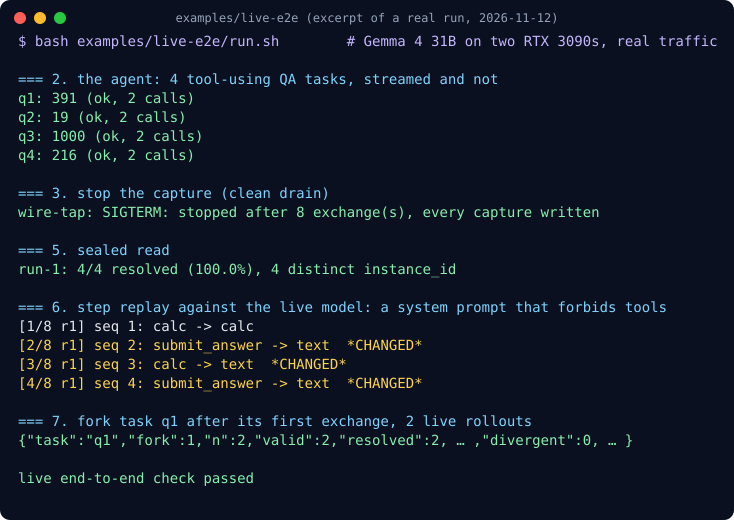
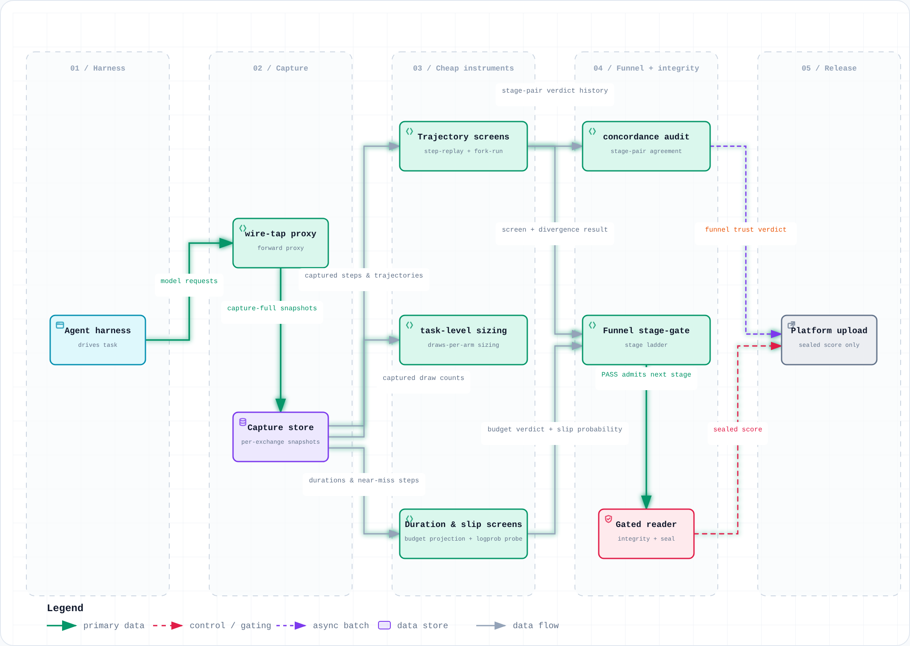
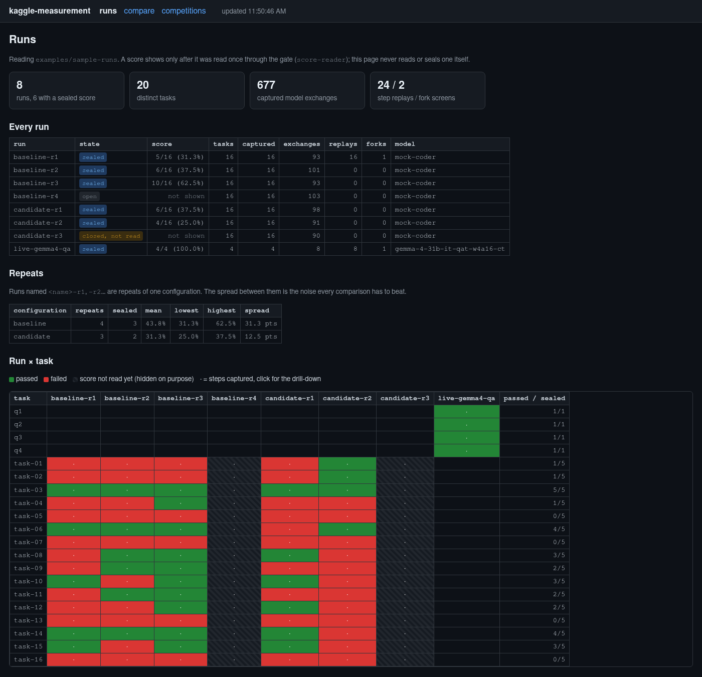
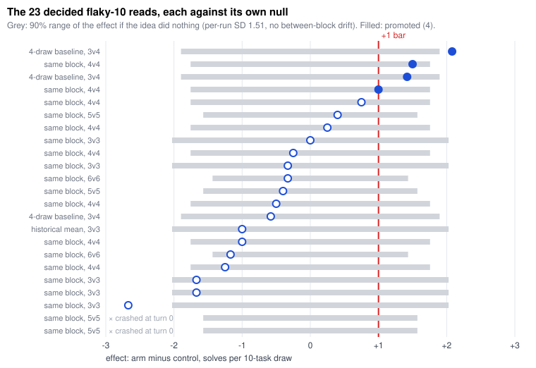
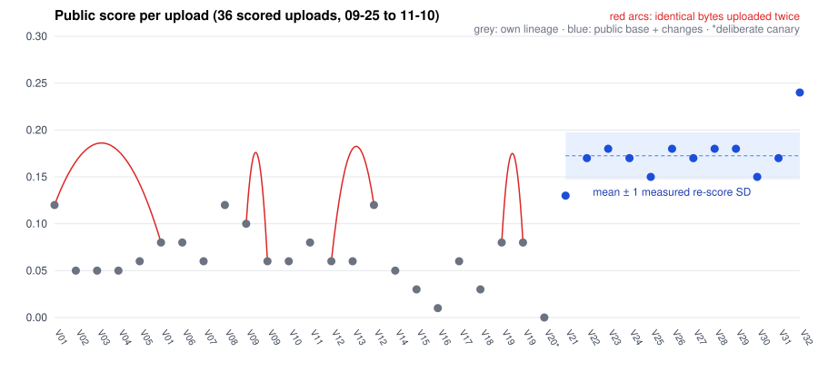

# kaggle-glassbox

**Know whether your agent got better, or just got lucky.**

On a small leaderboard, the same bytes can score two different numbers. In our Gemma 4 campaign, an
unchanged agent beat itself through our own promotion gate 20% of the time, and 4 of 23 ideas "passed"
where luck alone predicts 4.1. This toolkit captures every model call, screens ideas on captured steps
before you spend a scored run, seals each score the moment it is read, and tells you how much noise you are
looking at.

[](./LICENSE)
[](https://bun.sh)



## Works with

**Agents:** anything that talks to an OpenAI-compatible Chat Completions server, local or hosted (tested live on vLLM), streamed or not, with or without tools.

**Scores:** pass/fail per task, numeric per task, or a number only the platform computes (AUC, RMSE, hidden-label accuracy).

**Competitions:** Kaggle agent tracks, SWE-bench-style coding, QA and math, tabular. [What fits, and what does not](docs/guide.md#using-it-on-your-own-competition).

## How it works

<picture>
  <source media="(prefers-color-scheme: dark)" srcset="docs/measurement-pipeline-dataflow.dark.png">
  
</picture>

1. **Capture.** `wire-tap` sits between your agent and the model and snapshots every exchange. No opt-out.
2. **Screen.** Replay one captured step with a new prompt, or fork a task mid-run, before any idea gets a scored run.
3. **Seal.** Close each run with a hash of its artifacts. A score is read once, through a gate, and then it is frozen.
4. **Size.** `lb` tells you how far two runs drift by chance, and how many runs a decision needs.

## See it in 60 seconds

```sh
git clone https://github.com/rathko/kaggle-glassbox && cd kaggle-glassbox
bun install
bun run demo                       # the whole chain on a mock agent: no GPU, no key
bun run lb noise --tasks 50 --rate 0.30   # how far two runs drift by pure chance
bun run dashboard                  # open http://127.0.0.1:8180
```

Got a model server? `BASE_URL=http://127.0.0.1:8010 bash examples/live-e2e/run.sh` runs the same chain on real traffic in a few minutes ([details](examples/live-e2e/)).

## See it



`bun run dashboard` opens on runs the toolkit produced itself: repeats of one agent, every model call captured, a
step replay, a fork, and a real Gemma 4 run. Click a cell for the task's steps, compare two runs on the tasks they
share, or open a competition's figures. A score only shows once the gate has read it. [How it works](docs/guide.md#dashboard).

## Is your +1 real?



Grey is where a do-nothing idea lands by chance. Four ideas cleared the bar, and luck predicts about four.
`bun run lb aa` and `bun run lb draws` measure the same thing on your own runs, before you trust a result.

## Same bytes, different scores



Red arcs join identical bytes uploaded twice. `bun run lb rescore` turns pairs like these into the noise band you
should read every leaderboard move against.

## Use it on your competition

1. **Capture from the first run:** point your agent's base URL at `wire-tap`.
2. **Measure the noise** before you tune anything: `lb aa`, `lb rescore`.
3. **Close every run** with `run-end` the moment it finishes.
4. **Screen cheaply:** `step-replay` and `fork-run` before a scored run.
5. **Read scores only through the gate:** `score-reader` or `read-platform-score`.

The [full guide](docs/guide.md#using-it-on-your-own-competition) has the exact commands for each step, agent or tabular.

## Read before you rely on it

- **It measures, it does not improve your agent.** No prompts, agent code or winning settings are in here.
- **Capture and replay need Chat Completions,** one task per request, answers as text or `tool_calls`.
- **Statistics need repeat runs.** One run per idea cannot separate a real gain from noise; the tools tell you how many you need.

## Docs

**Start here:** [Full guide](docs/guide.md) · [Quick start](docs/guide.md#quick-start) · [Your competition](docs/guide.md#using-it-on-your-own-competition) · [Live end-to-end example](examples/live-e2e/)

**Tools:** [dashboard](docs/guide.md#dashboard) · [capture](docs/guide.md#capture) · [replay and fork](docs/guide.md#replay) · [integrity](docs/guide.md#integrity) · [noise floor](docs/guide.md#noise-floor) · [budget](docs/guide.md#budget) · [score quantisation](docs/guide.md#score-quant) · [analysis](docs/guide.md#analysis)

**The paper:** [Read it](competitions/gemma4-swe-agent/paper/paper.md) · [Gemma 4 SWE-agent data and scripts](competitions/gemma4-swe-agent/) · [Every number, mapped to its script](competitions/gemma4-swe-agent/docs/paper-reproduction.md) · [Docker](docs/guide.md#running-everything-in-docker)

## Open source, no lock-in

Apache-2.0. TypeScript on [Bun](https://bun.sh), no Python, no telemetry, no hosted service. New competitions get their own folder under [`competitions/`](competitions/).
