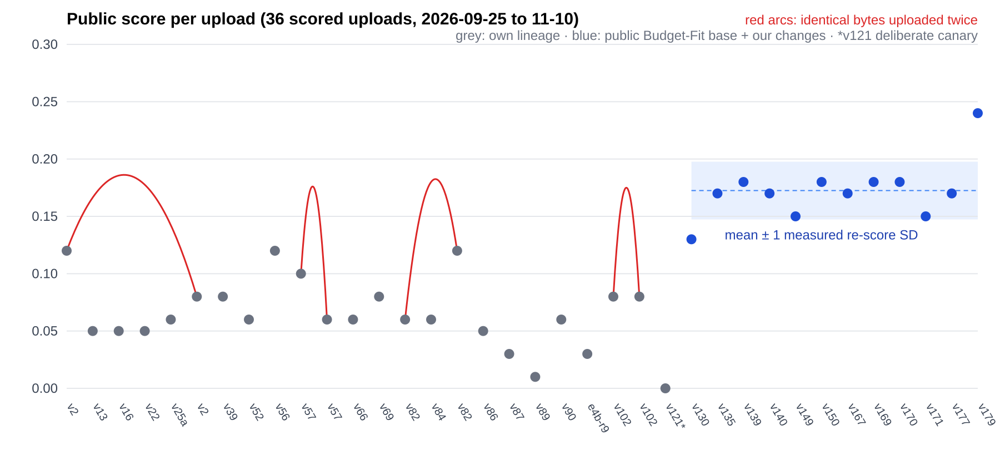
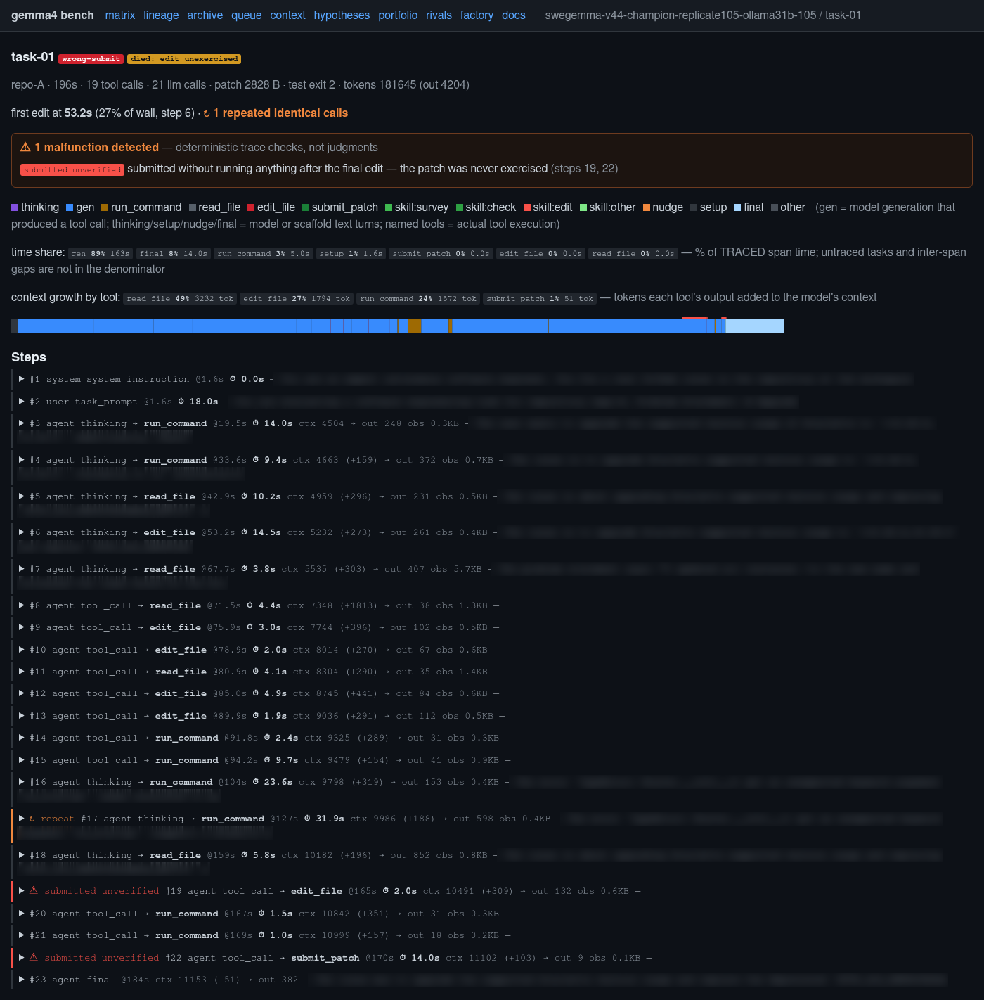
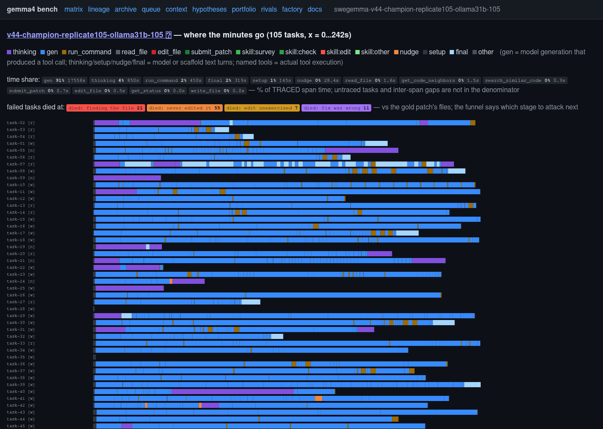
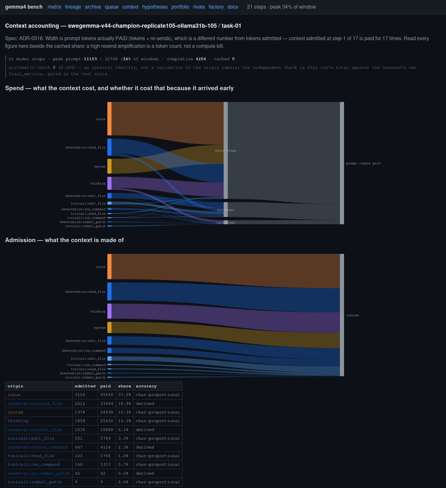
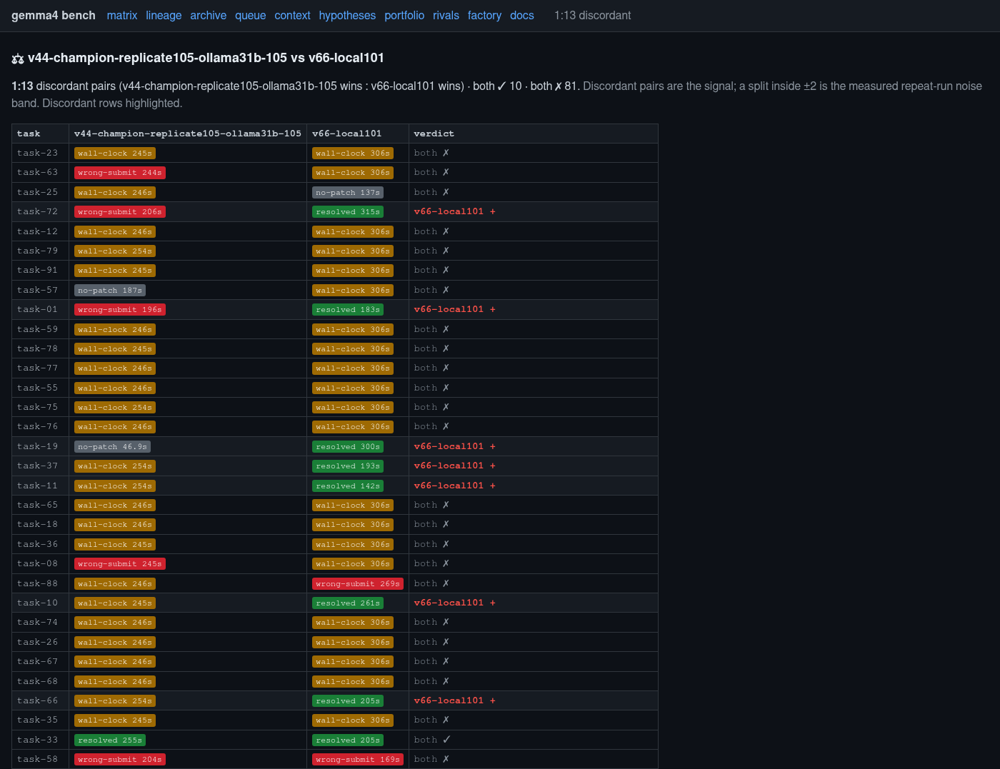
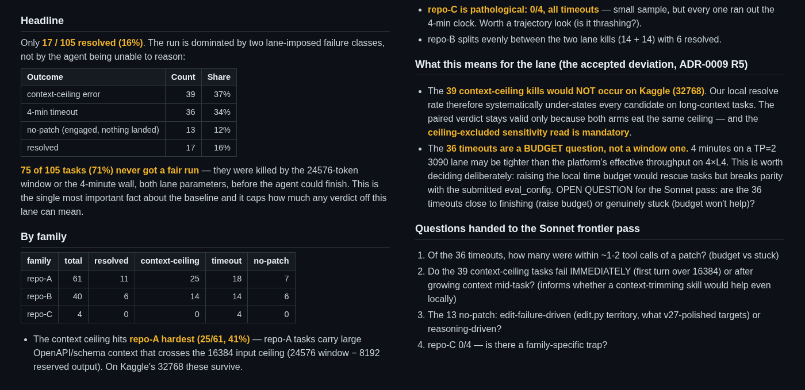
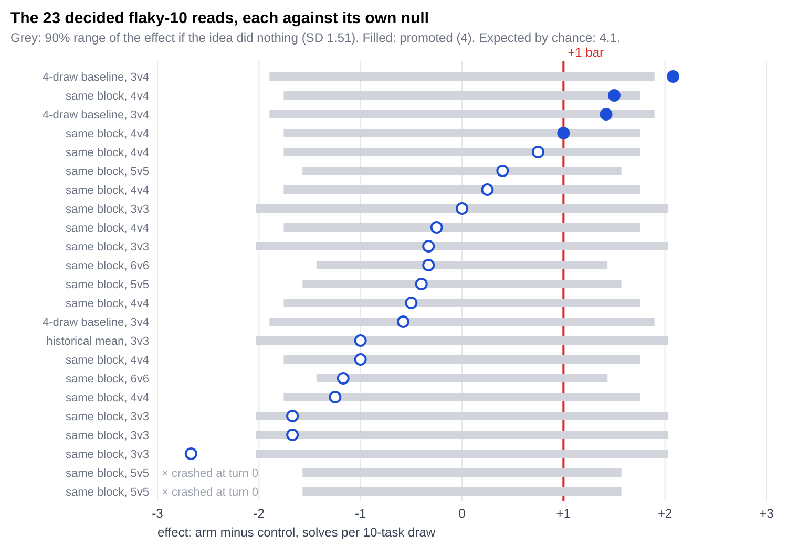

# Two Old GPUs and a Glass Box

### An open toolkit and dataset for seeing inside a coding agent and telling real gains from luck, built for the Gemma 4 Developer Agent challenge on 2020 hardware

## Abstract

You do not need a data-centre card to compete in a Kaggle agent competition. This paper releases kaggle-glassbox, an open toolkit and dataset that shows what happens inside a coding agent and whether a gain is real. Two RTX 3090s from 2020 were enough to double a Gemma 4 coding agent's public score, from 7 to 14 of 58 tasks. What made a real difference was seeing inside the agent. It turned the agent from a black box into a glass box. Every model call is captured. A dashboard shows each step of each task, where the time goes, and how versions differ. An automatic analysis reads every failed task and points at the next idea. A replay tool tries many options on captured steps in one night, before any full run. A small factory runs this loop while I sleep. The same tools also show when a small test mistakes luck for progress, and how to measure it. The capture, replay, analysis and noise tools work with any OpenAI-compatible agent, and they are open source under Apache-2.0 with the data. Anyone with a modest card can work this way, and I hope many more teams join in.

## 1. Introduction: you do not need a big card

The Gemma 4 Developer Agent competition gives every team the same locked Gemma 4 models inside a Google ADK agent [1]. I used the largest, `gemma-4-31b-it-qat-w4a16-ct`. The agent must fix real bugs in real repositories. About 120 hidden tasks, split evenly, feed the public and private leaderboards [2]. Public scores fit counts out of 58. Each team gets one upload a day, and a full run must finish in 12 hours.

A 31-billion-parameter model sounds like it needs expensive hardware. Fortunately, it does not. The 4-bit weights take about 18 GB, so it fits across two consumer cards with room for a long context. I describe the home build in a separate article (you don't need 512GB of RAM) [3]. Teams without any GPU can use Kaggle's free L4x4 notebooks [1].

I started from zero, with a first upload that crashed after ten hours. Later, I moved to a stronger public notebook as my base [1], and my tools carried over unchanged. The best upload now solves 14 of 58 tasks (Figure 1). This paper is about the method that got me there, more than about the score. The method has three parts: squeeze the hardware, see every step, and test ideas cheaply. I also report what did not work.

*Figure 1. Public score of every upload. Red arcs join identical bytes uploaded twice. The blue band is the average score after the base switch, plus or minus how far the same agent's score moves by chance when it is scored again (about 1.5 of 58 tasks). Uploads inside the band are not clearly different.*

## 2. Squeeze the hardware

I serve the model with vLLM on two RTX 3090s with a 32k context window. That gives about eight model calls a minute, enough for a 58-task run in about three and a half hours locally. I estimate that the platform runs about 1.6 times slower than the local server, so I keep a margin under its 12-hour limit.

Two habits gave most of the compute:

- **Build a factory that works at night.** Around the agent I built a small software factory. It takes the next idea from a list, runs the tests, reads the results, writes the failure analysis and starts the next test. In the morning I read which ideas survived, and I approve each upload myself. Over 47 days the machine ran about 880 test runs, over 11,000 task runs.
- **Do not repeat work.** Most ideas change one decision in the middle of a task. Instead of a full run, I replay the captured run up to that point and test only the change (Section 5).

One measurement made later work simpler. Within one run, task time tracks the number of tokens that the model writes (median correlation 0.97 over 97 runs). So each token that the model does not write saves time.

## 3. See every step

**Capture everything.** A small proxy between the agent and the model records every request and response, at every step. A run without capture refuses to start. This rule cost nothing and paid for itself many times.

**Look at one task.** The dashboard shows each task as a list of steps: what the model thought, which tool it called, what came back, and how long it took (Figure 2). Reading a few failed tasks this way taught me more than any score.

*Figure 2. One failed task from an early version (4 October, about 10% solved, on an early Ollama setup), step by step: which tool ran, when, for how long, and how much context it added. The checker flags the exact step where the agent submitted a patch it never tested. This run and those of Figures 3, 4 and 6 predate the released dataset.*

**Find where the time goes.** The profile view stacks the time of every task in a run (Figure 3). In early versions (also outside the released data), file reads made up 44% of the growth of the context, and one slow turn took more than half of a task's time. Later I found that the agent ran out of model calls far more often than out of time: in the released process data, about a third of task runs hit the call limit, and only about 6% hit the time limit. That told me to spend calls more carefully, and to stop adding rules that cost calls.

*Figure 3. Where the time goes in the same run. Each bar is one task, coloured by tool. Model generation takes 91% of the time. The tools are thin slivers. The labels above count where failed tasks died.*

**See what fills the context.** A context view splits every prompt token by source (Figure 4). In the task of Figure 2, the issue text entered the context once, but the model paid for it again on every turn: 37% of all prompt tokens.

*Figure 4. Context accounting for the task of Figure 2: what each turn paid for, and what the context is made of.*

**Compare versions.** A comparison view puts two versions side by side, task by task (Figure 5). Four days later, a new prompt with more time (306 s against 245 s) won 13 tasks and lost 1, including the task of Figure 2.

*Figure 5. Two versions four days apart, compared task by task.*

**A story from the captures.** The edit tool failed on 36% of calls. The step view showed that the model repeated the same broken call again and again. The captured probabilities showed why: the model wrote one merged token, a backtick plus a comma, with probability 0.93, where the correct delimiter had 0.0015. Two other teams report the same lost edit argument [4, 5]. Before I trained a fix, I counted how many tasks it could change. The answer was about one task in 58, so I dropped the planned LoRA training.

## 4. Let the analysis find the next idea

After every run, a language-model analysis job reads each failed task and writes a short note: where the agent went wrong and what might have helped. A second job reads all the notes of a run and groups the failures into classes, with counts (Figure 6). I used Claude Sonnet for this. The released version talks to any OpenAI-compatible server, including the same local Gemma. Across the last ten or so versions, these tables show which failure classes shrink and which stay.

*Figure 6. The structural failure summary of an early run (1 October, 16% solved). It found that 71% of tasks never got a fair run: 37% hit the local context window and 34% hit the local time limit. The platform window is larger, so part of the fix belonged in the test setup.*

Most ideas started as a hunch. The analysis told me which hunches pointed at a large class of failures and which pointed at a rare one. For example, it showed that by November most failed tasks ended with a wrong fix. About a third made no edit. So I moved the effort to the quality of the fix.

The analysis can also be wrong. For weeks, it read the agent's patch from an empty field. It concluded that the agent "never lands its fix", and I built remedies for a problem that did not exist. When I fixed the field, the picture changed. Lesson learned: check your instruments as hard as your agent.

## 5. Test ideas cheaply

A full run costs hours, and an upload costs a day. So every idea goes through a funnel of stages, each more expensive than the one before:

1. **Size it.** From captured runs, with no GPU: if the idea worked perfectly, how many tasks could it change?
2. **Screen it.** Replay many variants (forks) on captured states. I can try many options on a small set of steps in one night. One night of replay screens removed eight candidates without a single upload.
3. **Small test.** Ten tasks that sometimes pass (flaky tasks), three to six times per idea.
4. **Larger test.** 43 tasks, two to four times per idea.
5. **Upload.** Only the survivors.

For changes that need real tool output, I use capture forks. A proxy replays the first steps of a captured run exactly, so the real tools rebuild the repository, and then the live model continues with the change. A short self-test reproduced 13 of 13 tool outputs byte for byte. A longer one, through two context compactions, diverged on 13 to 24 of its 40 to 42 forced steps. The causes were a random temp path and an ordering bug. The released proxy handles both, but I have not rerun that long test. In all, I ran 334 fork rollouts to test new ideas quickly, and 283 of them replayed every forced step exactly.

Before most tests, I froze the pass bar and a copy of the version's files, so no result could move the bar afterwards.

## 6. What I learned

I tested about 180 ideas. Most did not work, which is normal. I group them into families. The repository lists 64 failed ideas, each as written before its test. What works best now stays private until the competition closes on 2 December.

| Family | What I tried | What I learned |
|---|---|---|
| Prompt rules | worked examples, edit-now rules, other wording | Most wording changes stayed inside the noise. |
| Edit-tool format | new edit formats, write-whole-file, retry recovery | Count the tasks a fix can change before you build it. |
| Multi-agent pipelines | investigator, judge and fixer stages | In every matched local test, a pipeline tied or lost to one agent. One pipeline used about 2.4 times the tokens. |
| Budget and time | call limits, time per task, stop after submit | The call limit binds before the clock does. Budget uploads scored 0.15 to 0.18, inside the noise. |
| Thinking and sampling | temperature, thinking length, output caps | Thinking uses the same output budget as the tool call. Leave room. |
| Context | bounded reads, capped tool output, notes on disk | Make the local window match the platform first, or the hardest tasks drop out unseen. |
| Fine-tuning | LoRA adapters on agent runs | An adapter slowed each call by about 15% and solved fewer tasks. |

**Small tests are noisy.** Here is a simple experiment that anyone can run. Upload the same agent twice, byte for byte. I did this four times. The two scores in a pair differed by up to 3 tasks, and a typical re-score moves by about 1.5 tasks. So one upload can only show a large change.

Then I asked the same question about the small test. It promoted an idea that gained one solve per run. How often does a useless idea clear that bar? The answer is 13 to 21% of the time. Over 23 ideas, luck alone predicts about 4 passes (4.1, or 3.8 without two builds that crashed before their first call). The small test passed exactly 4 (Figure 7). So the count gives no evidence that the test separated good ideas from neutral ones, although a few real gains can hide in the same total. Unchanged versions tell the same story. When I compared them with themselves, 14 of 62 comparisons cleared the bar, close to the 10.9 that luck predicts. A pre-registered check then ran one unchanged version 16 times. Split every possible way through the gate, it beat itself 20% of the time, inside the modelled range. The test would need about 14 runs for each arm, baseline and idea, to keep false passes under 5%.

The lesson is simple. If you build a cheap test, measure its noise first. Run an unchanged version several times, and count how often it "wins" against itself [6, 7]. Metrix187 calibrate a test before they use it [4]. I audit one after use. The two approaches fit together.

*Figure 7. Every decision of the small test. Grey: the range a useless idea would show (normal model, per-run SD 1.51 solves). Filled: the 4 ideas it promoted.*

There is good news in the same data. Re-scoring noise is only about half of what a simple coin-flip model predicts, because many tasks always pass or always fail. So careful local testing pays off.

## 7. The resource

Everything in Sections 3 to 6, except the factory, the checker of Figure 2 and the views of Figures 3 and 4, is in one Apache-2.0 repository: https://github.com/rathko/kaggle-glassbox.

- **Capture.** A proxy records every model call.
- **Screen.** Replay one captured step with a change, or fork a task mid-run on real tools.
- **Analyse.** Per-task failure notes and a cross-task summary, from any OpenAI-compatible model.
- **See.** A local dashboard shows runs, steps and side-by-side comparisons.
- **Seal.** A gate closes each run and freezes a score at the moment it is read.
- **Size.** A command-line tool measures re-score noise and A/A false passes, and how many runs a decision needs.
- **Data.** 3,985 task attempts from 197 runs, the task sets, the fork ledger, 64 failed ideas and the A/A runs.

The tools work with any agent that talks to an OpenAI-compatible Chat Completions server, so they also fit other agent, QA, maths and tabular competitions. A mock-agent demo runs capture, replay, sealing and the noise tools, with no GPU and no key: `bun install && bun run demo`.

## 8. Related work

Re-running agents on SWE-bench moves a single score by several points [8]. In this competition, one team found twenty agent changes inside the noise, and saw identical bytes score 0.18 and then 0.13 [9]. Metrix187 built a calibrated test and a cleaner grader [4]. Ren and Ahn calibrate an agent test with A/A splits before they use it [10]. This paper adds an open, frugal toolkit and dataset around these lessons.

## 9. How to start

1. Serve the model locally if you can. Two old 24 GB cards are enough. If not, use Kaggle's free notebooks.
2. Capture every model call from day one.
3. Read failed tasks step by step, and find where the time and the tokens go.
4. Size an idea before you build it, and screen it on replayed steps before you run it.
5. Run an unchanged version several times to learn how noisy your tests are.
6. Treat one upload as a weak signal.

## Limitations

The local setup is close to the platform, but it is not identical. Early on I also served a converted copy of the model with Ollama. Later vLLM ran the exact competition checkpoint. The RTX 3090 cannot run vLLM's e4m3 FP8 cache, so I used a 16-bit cache, and the 32k window still fit. The platform's vLLM version had a bug that blocked that window on these cards, so I run a newer version. The local server also cuts over-long requests that the platform rejects. The local tasks come from public repositories. The tests chose ideas after I saw earlier results, so the noise numbers describe this campaign and do not prove a general rate. Forks test a change only from the forked step onward. The evidence for the workflow is the findings it produced.

## Reproducibility

The repository (Section 7) has tests and architecture diagrams. Two scripts print every number from the released runs, and a table in `competitions/gemma4-swe-agent/docs/paper-reproduction.md` maps each released figure and number to the script that recomputes it. The runs behind Figures 2 to 6 predate the released data. The repository holds no agent prompts, task text or submission settings.

## References

[1] Kaggle, Gemma 4 Developer Agent. https://www.kaggle.com/competitions/gemma-4-developer-agent ; public base: Henao, Budget-Fit Single Agent. https://www.kaggle.com/code/verracodeguacas/gemma-4-agent-budget-fit-single-agent
[2] Kaggle, Gemma 4 Developer Agent, Data. https://www.kaggle.com/competitions/gemma-4-developer-agent/data
[3] Maciaszek. I built an EPYC 64-core 512GB RAM 48GB VRAM LLM server in my apartment. Medium. https://medium.com/@rathko/i-built-an-epyc-64-core-512gb-ram-48gb-vram-llm-server-in-my-apartment-60a8b8a2d355
[4] Metrix187. https://github.com/Metrix187/g4-evalkit
[5] dp-pcs. https://github.com/dp-pcs/gemma4-tool-call-reliability
[6] Kohavi et al. Trustworthy Online Controlled Experiments. Cambridge University Press, 2020. https://doi.org/10.1017/9781108653985
[7] Miller. Adding Error Bars to Evals. arXiv:2411.00640. https://arxiv.org/abs/2411.00640
[8] Bjarnason et al. On Randomness in Agentic Evals. arXiv:2602.07150. https://arxiv.org/abs/2602.07150
[9] fjcarmona78. https://github.com/fjcarmona78/gemma4-agent-noise-study
[10] Ren, Ahn. Closed-Loop Agent Evaluation. arXiv:2611.07051. https://arxiv.org/abs/2611.07051
