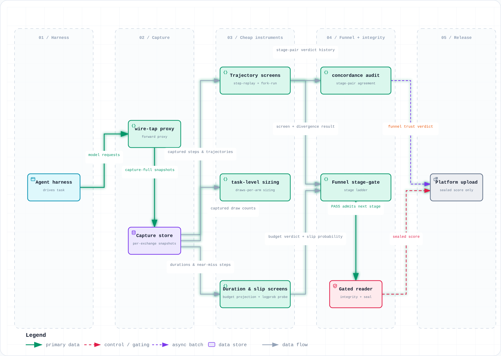
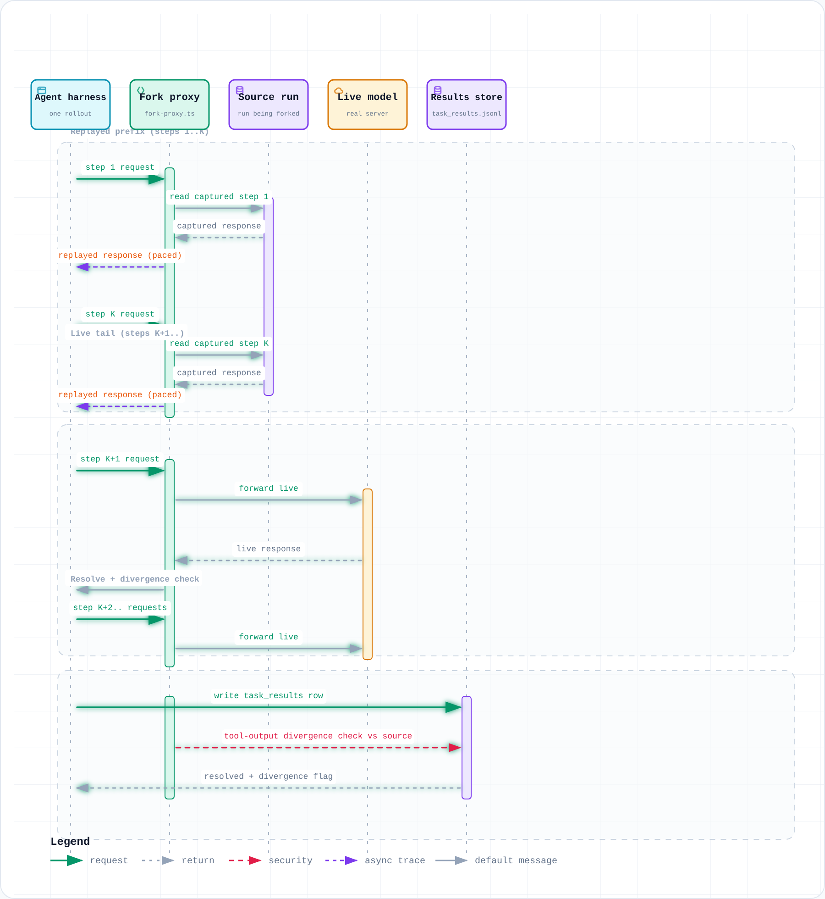

# kaggle-measurement: the full guide

A measurement toolkit for agent competitions on Kaggle and similar leaderboards: a Kaggle competition, a
private benchmark, any setup where one scored run costs real time or money and the score moves by a few tasks
between identical runs. The toolkit at the root is competition-agnostic; each competition it was used on gets
its own folder under [`competitions/`](../competitions/) with its anonymised data and the scripts behind its
numbers. The first one is a SWE-bench-style coding-agent campaign
([`competitions/gemma4-swe-agent/`](../competitions/gemma4-swe-agent/)), where getting the *measurement* right mattered as much as getting the agent right.

Repository: <https://github.com/rathko/kaggle-measurement>

No agent code, no working prompts, no dataset, and none of the configuration that scored best live here. The
paper's data (in `competitions/gemma4-swe-agent/`) describes the ideas that did NOT work, including some of their settings,
and the settings of the public baseline bundle they were measured against. Everything else is only the
instrumentation: how to capture what actually happened, how to cheaply screen a change before spending a
real scored run on it, how to keep a score honest once you have one, and how to tell a real result apart
from noise.

Stack: TypeScript + [Bun](https://bun.sh) (1.3 or later). No Python, no npm/npx.

## Quick start

```sh
bun install
bun run demo        # the agent path (capture, close the run, replay, sealed read, noise) on a mock Chat Completions agent, no GPU or key
bun test            # unit and integration tests, offline
bun run lb help     # the leaderboard noise CLI: noise, compare, paired, rescore, draws, aa, quant
```

Against a real model: [`examples/live-e2e/`](../examples/live-e2e/) runs a small tool-using agent through the
whole chain (capture, clean stop, compact, close the run, sealed read, live step replay, live fork) against any
OpenAI-compatible server, in a few minutes:

```sh
BASE_URL=http://127.0.0.1:8010 bash examples/live-e2e/run.sh   # MODEL defaults to the first model the server lists
```

No agent, just a submission file and a score (a tabular competition, for example):

```sh
mkdir -p results/run-1/artifacts && cp submission.csv results/run-1/artifacts/   # the exact bytes you upload
echo '{"python":"3.12","model":"lgbm-v3"}' > results/run-1/stack.json     # what your run used
# the two checks are your own attestations (you looked at the file and the stack); the tool records them, it does not compute them
bun src/integrity/run-end.ts results/run-1 --artifact-only --no-capture --check artifacts=ok --check stack=ok
# ...upload, wait for the platform's score, then:
bun examples/read-platform-score.ts results/run-1 --score 0.8312   # gate, seal, print (sealed as "public")
# later, when the platform publishes a final score for the same bytes:
bun examples/read-platform-score.ts results/run-1 --observation private --score 0.8207
```

Each `--observation` name (default `public`) is sealed once: a different score under the same name is refused,
so seal a score only once you have the number you want to keep under that name.

The leaderboard CLI needs nothing but numbers you already have (solved counts; for a continuous score see the
scope table below and use `draws --scale continuous`):

```sh
bun run lb noise   --tasks 50 --rate 0.30          # how far two runs drift by chance (all tasks equally hard: conservative)
bun run lb noise   --rates 0,0.2,0.5,1,1,0.9       # the same from per-task solve rates measured over repeat runs
bun run lb paired  --a-only 2 --b-only 8           # two runs on the same tasks: 2 solved only by A, 8 only by B
bun run lb compare --tasks 50 --a 15 --b 19        # 15/50 vs 19/50 on independent task samples
bun run lb rescore --diffs 2,-1,0,3                # per-run SD from resubmitting identical bytes
bun run lb draws   --sd 1.5 --bar 1                # runs per arm before a no-effect change rarely clears "+1 task"
bun run lb aa      --scores 5,4,6,5,3,5,6,4,5,7 --base 4 --idea 3 --bar 1   # how often the built-in gate promotes an unchanged agent
bun run lb quant   --score 0.1724 --tasks 58 --decimals 4   # which solved counts a shown score can mean
bun run lb draws   --sd 0.004 --bar 0.005 --scale continuous   # the same sizing for a continuous score (AUC, RMSE)
```

## Using it on your own competition

**What fits.** The tools assume a fixed slate of tasks, each scored pass/fail, and a score that is the
solved count (or share). That covers agentic coding, QA with an exact-match grader, math with a checked
answer, and most "solve N tasks" leaderboards. If your metric is continuous (RMSE, AUC, a per-task score
in [0, 1]), the seal still applies, and `lb rescore`, `lb aa` and `lb draws --scale continuous` work on
per-run scores; only the solved-count tools (`lb noise`, `compare`, `paired`, `quant`) do not. What
decides the read path is where the score comes from, not its type:

- you score each task row yourself and the score is their mean or sum: `score-reader.ts`
  (`--outcome-kind numeric` for per-task scores);
- any other score, whether the platform computes it or you compute an aggregate that is not a per-row mean or
  sum (AUC, RMSE, binary accuracy on hidden labels): put the scored files in `artifacts/`, close the run with
  `--artifact-only`, and hand the number to `examples/read-platform-score.ts` from outside the run.
Separately, the capture, replay and fork tools need an agent that talks to a model through the OpenAI
**Chat Completions** API on the standard `/v1/chat/completions` route (streamed or not; Bearer auth or none; other routes or auth schemes need a change
in `src/replay/endpoint.ts`); other endpoints, including the Responses API, are proxied and logged but not snapshotted.
Two more limits: each model exchange must belong to exactly one task (a harness that batches several questions
into one request cannot be attributed, replayed or forked per task, so turn batching off), and an answer must be
assistant text or modern `tool_calls` (a refusal-only, audio-only, reasoning-only or legacy `function_call`
answer is refused by the replay tools).
A non-agentic tabular pipeline has no trajectory to capture: skip capture (step 1) and the replay screens in
step 4, but still close the run (step 3) with `--artifact-only`, and read the platform's score through
`examples/read-platform-score.ts`, which gates and seals it (the tabular quick start above).

| part | binary per-task outcome | continuous metric |
|---|---|---|
| capture, compact, step replay | yes, for a Chat Completions agent | yes, for a Chat Completions agent |
| fork | yes, for a Chat Completions agent whose harness grades each task locally | with `--outcome-threshold T`: a numeric reward or score of at least T counts as success (`--outcome-direction lower`: at most T, for a loss); every rollout needs a locally readable per-task outcome, so with hidden labels use step replay instead |
| run-end record and sealed read | yes | a per-row mean or sum you compute: a rows-based close, then `score-reader.ts --outcome-kind numeric`; any other aggregate (the platform's, or an AUC/RMSE you compute): close with `run-end.ts --artifact-only`, then hand the number to `examples/read-platform-score.ts <run-dir> --score <n>` (or `--score-file` outside the run) |
| `lb noise`, `compare`, `paired`, `quant` | yes | no |
| `lb rescore`, `aa` | yes | yes, with per-run scores; `aa --direction lower` for a lower-is-better metric (RMSE, loss) |
| `lb draws` | yes | with `--scale continuous` |
| frontier analysis | coding agents only | no |

1. **Capture every model exchange, from the first run.** Point your harness at `src/capture/wire-tap.ts`
   instead of the model server, and have it send the task id in an `x-task-id` header. Any Chat Completions
   server on the standard route works (streamed or not, Bearer auth or none); other endpoints are logged only.
   One task per exchange, answers as text or `tool_calls` (see the limits above).

   ```sh
   bun src/capture/wire-tap.ts --port 8810 --upstream http://127.0.0.1:8010 \
     --log ./results/run-1/wire-tap.jsonl --capture-full ./results/run-1/capture &
   TAP_PID=$!
   for i in $(seq 150); do   # up to 30 s; answered locally, no seq used
     curl -sf http://127.0.0.1:8810/__wiretap/ready >/dev/null && break
     kill -0 "$TAP_PID" 2>/dev/null || { wait "$TAP_PID"; echo "wire-tap failed to start" >&2; exit 1; }
     sleep 0.2
   done
   curl -sf http://127.0.0.1:8810/__wiretap/ready >/dev/null || { echo "wire-tap not ready" >&2; exit 1; }
   # then set your harness's model base URL to http://127.0.0.1:8810; one wire-tap per run directory
   ```

2. **Measure the noise before you tune anything.** Run one unchanged agent several times (`lb aa`, with
   `--base`/`--idea`/`--bar` set to your split; the runs must be interchangeable, same config and same
   environment), and if the platform allows, resubmit identical bytes (`lb rescore`). `lb aa` scores one rule,
   the built-in gate `mean(idea) >= mean(base) + max(bar, SD(base)/sqrt(idea runs))`; for any other rule, pass
   your own predicate to `falsePass` in `src/noise-floor/aa-splits.ts`. Every later decision is read against this.
   Capture these baseline runs too (step 1): they are the trajectories your first replay screens will reuse.
3. **Close every run the same way, the moment it ends.** Stop wire-tap and wait for it to exit first (a late
   exchange would leave a raw snapshot, and `run-end` refuses the run). Then compact the capture per task (`capture-compact.ts`;
   with the `x-task-id` header no separate attribution step is needed), have your guard write `stack.json`,
   then write the immutable run-end record (`src/integrity/run-end.ts <run-dir> --check rows=ok --check stack=ok`):
   your checks plus a hash of the raw artifacts. The checks are your guard's attestations, not something this
   tool computes: `rows=ok` should mean you validated the result rows, and `stack=ok` that the environment
   matched the `stack.json` (which is then part of the hash). Anything done to the run after this point is
   checked against the record:

   ```sh
   kill "$TAP_PID"; wait "$TAP_PID" || { echo "capture incomplete: do not close this run" >&2; exit 1; }
   # wire-tap finishes open exchanges and their captures and exits 0; 1 if any were still open after WIRE_TAP_DRAIN_MS (30 s)
   # an agent run with task rows: compact the capture, then close (rows not keyed by instance_id: add --task-field <field>)
   bun src/capture/capture-compact.ts ./results/run-1/capture
   # only if your harness sends no x-task-id header: bun src/capture/capture-attribute.ts ./results/run-1 ./results/run-1/capture --adapter my-adapter.json
   bun src/integrity/run-end.ts ./results/run-1 --check rows=ok --check stack=ok
   # task rows from a pipeline with no model traffic
   bun src/integrity/run-end.ts ./results/run-1 --no-capture --check rows=ok --check stack=ok
   # a score computed from submitted files (by the platform or by you), no model traffic
   bun src/integrity/run-end.ts ./results/run-1 --artifact-only --no-capture --check artifacts=ok --check stack=ok
   # an agent whose score comes from submitted files: the capture is verified too, against an id-only task inventory
   #   (one row per task, no outcomes), e.g. {"instance_id":"q1"} per line in ./results/run-1/task_results.jsonl
   bun src/integrity/run-end.ts ./results/run-1 --artifact-only --check artifacts=ok --check stack=ok --check capture=ok
   ```

4. **Screen ideas cheaply.** Replay captured steps with a changed prompt or parameter (`step-replay.ts`), or
   fork a task mid-trajectory (`fork-run.ts`), before any idea gets a scored run. Read scores only through
   the gate: `score-reader.ts` (task rows) or `examples/read-platform-score.ts` (an artifact-only run)
   verifies the record, seals the run, and only then prints the number; after the seal, no repair is allowed.
5. **Size the decision.** `lb draws` sizes the false-pass side only: how many runs per arm keep a no-effect
   change from clearing your bar. It is not power: a real effect exactly at the bar still passes about half
   the time. Feed it the upper end of the `lb rescore` interval (or your A/A spread), not the point SD.
   `lb paired` compares two runs on the same tasks.

### The run layout

The integrity and analysis tools assume one directory per run:

| path | contents | needed by |
|---|---|---|
| `task_results.jsonl` | one JSON row per task: a task id and an outcome | required for row-scored runs; for `--artifact-only`, only an agent run with `--check capture=ok` needs it, as an id-only task inventory |
| `capture/` | `wire-tap.ts --capture-full` snapshots, then `capture-compact.ts` output | replay, fork, analysis |
| `patches/` | optional: the agent's output per task | integrity hash, analysis |
| `artifacts/` | required for `--artifact-only` runs, optional otherwise: only what you submitted (`submission.csv`, model files, predictions), any depth; the platform's score arrives later and is never written into the run; copies only, a symlink or other non-regular entry is refused, since it would seal a path rather than the bytes | integrity hash |
| `stack.json` | the environment and config your guard recorded (model, server, versions, settings); required, as parseable JSON, when you record `stack=ok` | integrity hash |
| `instruments.runend.json` | written once by `run-end.ts` | `score-reader.ts`, repairs |
| `score-read.json`, `score-read.obs-<name>.json` | the seals, written once by the readers (`public` in `score-read.json`) | refusing a second read, repairs |

Keep or copy a run directory whole: the record and seals only mean something next to the bytes they cover.

The default row fields are `instance_id` and `resolved` (true/false or 1/0). `score-reader.ts`,
`fork-run.ts` and `run-end.ts` take `--task-field` (`score-reader.ts` and `fork-run.ts` also `--outcome-field`); `score-reader.ts` resolves each run to its real path, and naming the same run twice (an alias, a trailing slash, a symlink) is a usage error; the rate and budget tools take their own field flags.
The frontier analysis is fixed to this layout and written for coding agents (see [analysis](#analysis)).
`capture-attribute.ts` reads your harness's own traces through an adapter file (`--adapter`, worked example in
`examples/attribution-adapter.json`): rows file and fields, a per-task trace path template with `{id}`, the
trace's step/call/text fields, and an optional per-task done marker for the serial time cross-check. With no
adapter it attributes only snapshots that carry a harness task id; skip it entirely when your harness sends
`x-task-id`. If your harness writes something else, a ten-line converter to this
layout is the intended adapter. For a tabular competition, put the submitted file in `artifacts/`; it is
then part of the sealed record. A run scored from submitted bytes rather than task rows closes with
`run-end.ts <run-dir> --artifact-only --no-capture --check artifacts=ok --check stack=ok` (an agent run uses
`--check capture=ok` instead of `--no-capture`, plus an id-only `task_results.jsonl`): a tabular run needs no `task_results.jsonl`,
and `artifacts/` must hold the scored files. The platform's score does not exist at run end, so
`examples/read-platform-score.ts` takes it from outside the sealed run (`--score 0.8312`, or
`--score-file <path outside the run>` with an optional `--field`), then gates, seals and prints. The seal records the whole score read (score,
source and, for `--score-file`, field and sha256); any later read must match it exactly. The platform reader
refuses a run that was not closed with `--artifact-only` (`examples/read-continuous-score.ts` is the same
reader under its earlier name).

`run-end.ts` checks the capture rather than taking your word for it. It refuses a run with task rows that has
no `capture/` (pass `--no-capture` for a pipeline with no model traffic). It parses every archive line and
checks each archive against its manifest entry (exchange count, first and last seq) before it records a computed
`capture=ok`. An artifact-only agent run can add `--check capture=ok` to have its capture verified the same way; it then keeps
an id-only `task_results.jsonl` (one row per task, no outcomes) as its task inventory, and every task in it needs
a captured exchange. `capture=ok` means replayable: every exchange must pass the replay tools' check (2xx, no
error, a usable answer, a finished stream, where a bare `event: error` counts as an error). Close a run whose
upstream failed mid-way with `--check capture=fail:<why>`.
It also checks coverage: every task in `task_results.jsonl` must have at least one captured exchange attributed
to it (the `x-task-id` header, or `capture-attribute`). A task that made no model call is waived by name with
`--uncaptured-ok <id,...>`, and the waiver is recorded in the run-end record; `--task-field` names the id field
(default `instance_id`).
Only archives listed in `capture/manifest.json` are ever read; `capture-compact.ts` refuses a capture
directory holding any other `.jsonl.gz`. Every capture reader refuses an archive whose contents disagree with
the manifest, and an exchange with no HTTP status or a status outside 200..299. A replayable exchange needs a
non-empty answer: text, or a complete list of tool calls. A streamed answer whose `finish_reason` is not a
string, or whose tool-call or choice indexes have a gap, is invalid.

Per-task scores you compute yourself (partial credit, a per-task metric) go through
`score-reader.ts --outcome-kind numeric --outcome-field <field> [--aggregate mean|sum]`. The kind, the aggregate
and the value are sealed, so a sealed run cannot be re-aggregated. `score-reader.ts` reads each run's `task_results.jsonl` once, verifies
exactly those bytes against the run-end hash, scores them, and seals their sha256 (`rowsSha256`). The mean cannot overflow, and a non-finite
aggregate is refused before sealing. `lb aa` and `falsePass` let ties pass with a slack of a few ulps of the
compared values, so a small continuous bar is respected. The gate compares means after removing a common offset,
and a verdict that rounding would decide (a huge spread of scores against a tiny bar) is a usage error: rescale. Readers lock each run (`score-read.lock`) from the integrity check through the seal; if a reader
was killed and left a lock behind, delete the file.

Count and concurrency flags (`--n`, `--pool`, `--repeat`, `--limit`, `--concurrency`, ...) must be positive
whole numbers; anything else is a usage error (exit 2). A task id that is not a safe file name (`a/b`, `../x`)
becomes a slug plus a short hash in default fork tags and adapter `{id}` paths; an explicit `--tag` must already
be safe. Every CLI refuses unknown, duplicate or valueless flags
and the wrong number of positional arguments with exit 2, before it writes anything.

## Architecture

<picture>
  <source media="(prefers-color-scheme: dark)" srcset="measurement-pipeline-dataflow.dark.png">
  
</picture>

Capture is unconditional and sits upstream of everything else. The cheap instruments (step
replay, fork screens, budget projection, the logprob probe) all read the same capture store
independently and never re-run the harness. The funnel refuses to admit a stage without a
recorded PASS at the stage below it; the gated reader refuses to print a score before checking
integrity. See [`docs/example-preread-adr.md`](example-preread-adr.md) for how a stage's PASS
gets pre-registered, and the [replay](#replay) section below for a sequence diagram of one fork.
The [frontier analysis](#analysis) is a further reader of the same capture store: a cheap model
writes a post-mortem per task after every run, so a closeout reads mechanisms, not only a count.

## The discipline this encodes

Every one of these tools exists because of a specific, recurring way measurement goes wrong when
you're iterating on an agent against a small, expensive, noisy evaluation:

- **A single scored run is one draw from a coin flip, not a verdict.** With a few dozen to a few
  hundred tasks, the difference between two prompts is often smaller than the noise two draws of
  the *same* prompt would produce against each other. See [`noise-floor`](#noise-floor) — compute
  the noise floor *before* you argue about a result, not after you like the result you got.
- **Capture everything, with no opt-out, or you can't ever re-examine a surprising run.** If a run
  looked wrong after the fact, the only way to find out why is to look at the actual per-step
  model input and output. That's only possible if it was captured *at run time* — there's no
  reconstructing it later. See [`capture`](#capture).
- **Screen cheaply before you spend a scored run.** Re-running a whole task to test one prompt
  tweak pays for every step, including the ones you already know the outcome of and aren't trying
  to change. Replaying one captured step, or forking from a mid-trajectory state and only paying
  for what happens after it, is dramatically cheaper and answers many of the same questions. See
  [`replay`](#replay).
- **Size a candidate fix at the task level before you believe it generalises.** A budget argument
  built on `cap × n_tasks` ignores that most tasks don't run to the cap; it makes some changes
  look free and others look unaffordable for no reason connected to what they'd actually cost. See
  [`budget`](#budget).
- **Pre-register what "repairable" means, and seal the score once it's read.** If any post-run
  check can be quietly re-run until it passes, or a score can be "fixed" after someone has already
  seen it, you no longer have a measurement — you have whatever number you wanted. See
  [`integrity`](#integrity).

## Layout

```
src/
  cli/          leaderboard.ts: the noise questions from the command line (see Quick start)
  capture/      full-fidelity capture of every model exchange, and the task-attribution pass
                that figures out which captured exchange belongs to which task
  replay/       cheap screens: replay one captured step with a mutation, or fork a live
                rollout from a mid-trajectory state
  analysis/     frontier analysis: a cheap model writes a post-mortem per task from the
                captured trajectory, then one failure taxonomy with ranked levers per run
  integrity/     the score-gate repair rule, a generic gated score reader, and the one
                allowed repair tool
  budget/       measured-duration cap projection and cross-environment rate-scaled projection
                for a candidate change's full-slate cost
  noise-floor/  binomial noise floor, a two-proportion significance test, re-score noise from
                paired identical-bytes draws, and head-to-head win/tie/loss probabilities
  preread/      machine-readable pre-registered reads: a band is a validated data structure,
                frozen before the score exists, not read in the same breath as the number
  queue/        the test-funnel stage gate: a stage may not be entered without a recorded
                PASS at the stage below it, except two logged exceptions
  concordance/  does a cheap evaluation stage actually predict a more expensive one? stage-pair
                concordance tables and a constant-baseline comparison
  score-quant/  recovers the integer task count behind a leaderboard score that's been floored
                or rounded to a fixed number of decimals
  stats/        small supporting statistics: chi-square and F distributions, a seeded PRNG,
                and the tie-aware draws-per-arm calculation behind `lb draws`
docs/           architecture diagrams and an example pre-registered-ADR template
examples/       demo.ts: the core path against a mock model and harness (bun run demo);
                live-e2e/: the same path against a real OpenAI-compatible server
test/           integration tests: the capture -> compact -> attribute -> fork chain end to end
scripts/        repo checks: every markdown link resolves, .dockerignore mirrors .gitignore
competitions/   one folder per competition the toolkit was used on, each with its own data/,
                scripts/ and docs/; gemma4-swe-agent/ holds the anonymised data and the scripts
                behind the paper "Two Old GPUs and a Glass Box"
```

A new competition gets a sibling folder under `competitions/` (its data, the scripts that recompute its
numbers, and later its dashboard), and keeps using the toolkit at the root unchanged.

Every tool is a standalone `bun` script (or, for `noise-floor` and the `fork-run-steps`/`score-gate`
libraries, a small module meant to be imported). Paths are CLI arguments or environment variables; the
only layout assumed is [the run layout](#the-run-layout) above.

## capture

**`src/capture/wire-tap.ts`** — a transparent forward proxy that sits between your agent harness
and an OpenAI-compatible chat-completions endpoint and logs both sides of every exchange. Config
files tell you what a harness is *supposed* to send; this tells you what actually went over the
wire. `--capture-full <dir>` writes one full request+response snapshot per exchange —
the input every replay/fork tool below needs. Snapshots are written owner-only (`0600` in a `0700` directory;
`--shared-perms` for a team box) and pass through a best-effort redaction (`src/capture/redact.ts`):
credential-named keys at any depth and token-shaped strings (Bearer/Basic, `sk-`, `ghp_`, URL passwords) are
replaced. Treat captures as sensitive anyway: they hold every prompt and answer. `--inject '<json>'` merges extra keys into every
outbound request, for probing a parameter your harness can't be configured to send; any run
through it with `--inject` set is an instrument modification, not a baseline.
Streamed answers (`stream: true`, server-sent events) are forwarded chunk by chunk as they arrive
and captured reassembled into the same shape as a non-streamed answer; the upstream status and headers
(request ids, rate-limit headers) reach the client unchanged. Snapshots are written only for
`chat/completions` paths; other endpoints are proxied and logged, not snapshotted. A stream that ends
without `[DONE]` and without a finish reason on every choice, or carries an error event, is captured but marked invalid, and every
replay tool refuses it. wire-tap refuses a capture directory that holds any entry at all; `--append` resumes
the numbering after the highest existing exchange. A streamed exchange's snapshot is written before the client
sees the end of the stream; if it cannot be written, the client gets an `event: error` in place of `[DONE]`, never a
clean answer. A raw snapshot found in `capture/` after run end makes the run unreadable. A streamed event whose
data is valid JSON but not an object (`null`, a number, an array) marks the stream invalid. `--upstream` may carry
a path prefix (`https://host/api/v1`); a request for `/v1/...` is joined once, never `/v1/v1/...` (fork-proxy too). `capture-compact` checks the existing manifest and archives
even when there is nothing new to compact. Each snapshot records when the request arrived
(`req_at`) and when the answer finished (`at`).

```sh
bun src/capture/wire-tap.ts --port 8810 --upstream http://127.0.0.1:8010 \
  --log ./results/run-1/wire-tap.jsonl --capture-full ./results/run-1/capture
# point your harness's model base URL at http://127.0.0.1:8810 instead of 8010
```

Both proxies bind 127.0.0.1. A harness in a container cannot reach the host's loopback: start wire-tap (or
fork-run) with `--listen-host` set to the container bridge address or 0.0.0.0; a non-loopback bind prints a
warning. fork-run's `--advertise-host` sets the host the harness gets in `{proxyUrl}`, for example
`host.docker.internal`. The proxies have no idle timeout, so a non-streamed answer that takes many minutes is not
cut off. The task-id header (`x-task-id`, or the name given to `--task-header`) is read by the proxy and removed
before the request goes upstream, together with hop-by-hop headers, so your task ids never reach the model
provider. If a capture cannot be written, the client's stream ends in an error event only; no `[DONE]` is sent
for that exchange. A replayed answer whose body carries an `error` is refused, even if it also has choices. A streamed event that
carries several choices must give each one a distinct index (below 1024), or the stream is invalid. `slip-logprobs`
validates every capture group of each selected run as one trajectory before it sends anything.

`capture-compact` is incremental: it checks every existing archive against `manifest.json` on each run, and
merges a later batch for an already-compacted task into its archive atomically. Compacted and attribution files are
`0600` by default, `--shared-perms` for `0664`. It parses every snapshot first and aborts, writing and deleting
nothing, if any does not parse, if any seq is missing, not a positive whole number, or repeats one already
compacted, or if `capture/` holds an archive that `manifest.json` does not list. Archives are staged and
verified first, the manifest is replaced atomically, and raw files are deleted last. `capture-attribute` fails unless every task that reports model calls gets at
least one snapshot and at least `--min-coverage` of snapshots (default 1.0) are assigned. A harness task id on a snapshot is
authoritative; trace and time matching only fill snapshots without one, and a tie leaves the snapshot unassigned. Serial time
windows are (previous end, end] on request arrival, and a snapshot after the last end belongs to no task; the
optional `start_marker` gives each task [start, end + 5 s], cut at the next task's start. A harness task id that names no task in the result rows fails the
attribution, and nothing is written.

**`src/capture/capture-compact.ts`** — groups a raw capture directory's per-exchange JSON files by
task, gzips each task to one `task-<hash>.jsonl.gz`,
verifies the round-trip before deleting anything, and writes `manifest.json`. Grouping uses, in order: the
task id your harness sends in an `x-task-id` request header (wire-tap records it; start `wire-tap.ts` with
`--task-header <name>` for another header), which is exact and makes `capture-attribute.ts` unnecessary; a `--group-by <regex>` whose
first capture group names the task in the request; or, by default, the first user message.

**`src/capture/capture-attribute.ts`** — for harnesses that cannot send a task id: figures out which
captured exchange belongs to which task, by matching tool-call content against your harness's own per-task traces (works under any
concurrency), cross-checked against log-file mtimes when the run was serial. Writes
`task-index.json` and adds `instances` to each `manifest.json` entry. A harness with no tool calls (QA, math)
adds `prompt_field` to the adapter: the row field holding the task's own prompt, matched verbatim
(whitespace-normalised) inside the request, at any concurrency; captured answers are also matched against the
agent text in your traces. Any non-empty prompt works; one under 8 characters (`2+2?`) must end a user message,
so a short prompt that also appears in a shared system prompt does not claim every request.
`examples/attribution-adapter-qa.json` is a worked adapter for a tool-free QA agent. Every row's `calls_field`
value must be a whole number >= 0. `calls_field` is checked against every attributed model exchange (set
`calls_count: "tool_turns"` if your harness counts only tool-offering requests). When one capture group holds
several tasks' exchanges, `capture-attribute` writes a per-seq map (`seq_tasks`) into the manifest; fork,
frontier and run-end take each task's trajectory from its own exchanges only, a group listing several tasks
with no such map is refused, and `frontier-analyse` refuses a task with no captured exchange. When
`capture-compact` merges new exchanges into a group that `capture-attribute` already attributed, it drops that
attribution and marks the group `attribution_stale`: re-run `capture-attribute` before `run-end` (a group
attributed by the `x-task-id` header stays exact). `run-end` refuses a capture with a stale group, or with any
exchange in an attributed group that maps to no task. This is what makes
`fork-run-steps.ts` able to say "give me task X's captured trajectory."

**`src/capture/capture-required.ts`** — the "every run captures, no opt-out" guard. Every runner
script in your harness that is *not* the one designated capturing runner imports this module for
its side effect, which refuses immediately. It has no function to remember to call — importing it
*is* the guard, so a runner can only forget to capture by forgetting to import it, which
`capture-required.test.ts` shows how to check for across a runner directory.

## replay

**`src/replay/step-replay.ts`** — the precision screen. Select one or more captured steps (by
sequence number, a text grep, or "only the last step of each conversation"), apply a mutation
(swap the system prompt, drop tools, merge sampling params, truncate the message history, append a
user message), resend to a live model server, and report whether the next tool call changed. No
task re-run, no grading — just "did this change what the model does next." `--compare auto` (the default)
compares the full tool-call sequence of every choice (arguments included), or the normalised text when neither answer calls a tool, so it also works for
text-only agents; `tool` and `content` force one or the other. `--system-file` inserts a system message when the
trajectory has none (recorded as `system_inserted`). `replay-states` merges all capture groups of a run into one
trajectory, so a retry is the run's true next call.

```sh
bun src/replay/step-replay.ts --dir ./results/run-1/capture --seq 40-60 \
  --system-file ./candidate-prompt.md --out ./results/screen-candidate-a.jsonl \
  --base http://127.0.0.1:8010            # your model server; for a hosted one set REPLAY_API_KEY too
```

`step-replay` compares every choice by index. By default (`auto`) it compares the full tool-call sequence with
arguments (JSON arguments compared canonically), so `submit_answer({"answer":"4"})` against `"5"` is a change;
with no tool calls it compares the normalised text, and `--compare tool` compares tool names only. It refuses an
existing `--out` unless you pass `--append`, and every row records the mutation it ran (`config`,
`config_sha256`), so rows from different candidates can be told apart. A states index must give `corpus`,
`run` and `group` as non-empty strings and `seq` as a positive whole number, with no (corpus, run, seq) twice;
entry states, like onsets, are cut from the run's whole validated trajectory. Each row also needs `fingerprint`
(a non-empty string or number) and `flagged` (true/false), with optional `ambiguous` (true/false) and `outcome`
(a string). `slip-logprobs` refuses a response without well-formed `logprobs.content` (a server that ignores
`logprobs: true`) as an error, never as a no-match.

`step-replay`, `replay-states` and `slip-logprobs` all send to `--base` (an OpenAI-compatible server) and, if
`REPLAY_API_KEY` is set, authenticate with it as a Bearer token.

**`src/replay/fork-proxy.ts` + `src/replay/fork-run-steps.ts` + `src/replay/fork-run.ts`** — the
forking screen. `fork-proxy.ts` answers a task's first K model requests with the *captured*
responses from a source run (so your harness rebuilds the same repo/sandbox state) and forwards
everything after that live, preserving the source run's wall-clock pacing so the live part starts
with the same time budget left. `fork-run-steps.ts` loads one task's captured trajectory from a
source run. `fork-run.ts` is the orchestrator: fork a task at step K, run N rollouts in parallel
under **your own harness** (you supply the invocation as a command template — this tool is
harness-agnostic by design), and report how many resolved plus how many rollouts diverged from the
source run's tool outputs (a sign the rebuilt state wasn't actually identical).
A rollout counts as valid only if the harness exited 0, its outcome is readable, all K steps were
forced, and none diverged; the rate is over valid rollouts, and the rest are counted by reason in
`invalid_reasons`. Divergence compares the full normalised request history (tool calls with their names,
arguments and ids, tool results with their call ids, and message text), skipping `--ignore-roles` (default
`system`; `none` compares all), so a prompt fork stays comparable. The pacing clock starts at the source run's first request arrival, and readiness is
checked on the proxy's own `/__fork/ready`, which never reaches the upstream. A single-row result file is taken
as the task's row only if the row has no task field; a result file with two rows for the task makes the
rollout invalid. `--outcome-threshold T` counts a numeric outcome of at least T as success; add `--outcome-direction lower` for a loss or an error (at most T). The direction is recorded in the fork output. `replay-states --entry N` takes exactly N entry states spread evenly over the whole sorted list, never the first N. `replay-states` arm
names must be unique across control, prompt and sampling arms, sampling arms take finite numbers only, and
ambiguous index rows still count toward a run's trajectory.

Every replay tool refuses a trajectory that contains a non-2xx, errored, choiceless or invalid-stream exchange
and names the sequence numbers; nothing is silently dropped. Every response choice must be an assistant message with
text content or a non-empty list of tool calls, each with an id, `type: "function"`, and a string name and
arguments; otherwise the capture is refused, and live replay throws. `step-replay --seq` takes positive whole
numbers and `a-b` ranges with no overlaps; a selection that matches nothing exits nonzero before writing anything. Each whole trajectory is validated before any
`--seq`/`--grep`/`--limit` selection, so a selection cannot dodge a broken exchange. The frontier analysis
likewise refuses, and reports as failed, a task whose trajectory has an invalid exchange.

```sh
bun src/replay/fork-run.ts --source-dir ./results/run-1 --task my-task-007 --fork 12 --submission ./candidate \
  --harness-cmd "bun,./my-harness.ts,{submission},{runName},{taskFile}" \
  --env '{"MODEL_BASE_URL":"{proxyUrl}"}' \
  --upstream http://127.0.0.1:8010 \
  --results-root ./results --n 6 --pool 6
```

`--upstream` is where the live part of each rollout goes after the forced prefix: your model server, local or
hosted (default `http://127.0.0.1:8010`).

**`src/replay/replay-states.ts`** — next-call replay across *many* previously-seen decision points
("states") and *many* candidate arms at once, for diagnosing a recurring failure mode: across
every place you've seen a behaviour go wrong before, does candidate arm A change what happens
next, versus the captured (control) arm? States are split by source trajectory and alternated
selection/confirmation, so you can't pick a winner on the data you confirm it on. The default
classifier demonstrates the pattern for a generic structured file-edit tool call; swap it for your
own tool's shape.

**`src/replay/slip-logprobs.ts`** — when a model "almost" does the right thing, how close was the
alternative to actually winning? Re-sends a captured near-miss once with `logprobs` +
`top_logprobs`, locates the token at the position your `--pattern` regex matches, and reports the
probability the model actually assigned to your `--alt-token` there. If that probability is
non-trivial, a cheap intervention (grammar constraint, logit bias, a one-line prompt change) is
plausible; if it's near zero in the real logits, you're not one token away from a fix.

Sequence of one forced-prefix fork (`fork-proxy.ts` + `fork-run.ts`):

<picture>
  <source media="(prefers-color-scheme: dark)" srcset="forced-prefix-fork.dark.png">
  
</picture>

## preread

**`src/preread/preread.ts`** — a machine-readable pre-registered read. A prose "band" in a design
doc cannot be applied by a machine, so the band ends up read in the same breath as the number —
which means the closeout was decided *after* seeing the score, the one thing pre-registration is
supposed to prevent. This module makes the band a validated data structure that lives in your
change doc (an ADR, an RFC, whatever you call it) *before* a run happens. `extractBlock` pulls the
single ` ```preread ` fence out of a document (zero or two is an error); `validate` / `parseDoc`
check it: exactly one `min: null` catch-all band, strictly descending bounds, and a verdict that is
never `"confirmed"` — a pre-registered read can say `supported` (worth confirming), `measured-null`,
or `refuted`, but promotion to `confirmed` is a human decision made after a real downstream result,
not something a local gate can grant itself. `classify(bands, value)` applies the bands to a number
once it exists.

```sh
# see docs/example-preread-adr.md for a full template with the fenced block
```

```ts
import { parseDoc, classify } from "./src/preread/preread";
const pre = parseDoc(adrText, knownHypothesisIds, knownMetricNames); // either set may be null
classify(pre.bands, observedValue); // -> { verdict, label }
```

## queue

**`src/queue/stage-gate.ts`** — enforces a test funnel (cheap screen → … → expensive full run) in
code, so a stage can't be skipped by habit or deadline pressure. Without enforcement, every idea
tends to go straight to the most expensive, most realistic stage, because that's the one that
*feels* like the real answer — which is enormously wasteful when most ideas turn out to do
nothing. `stageOf` classifies a slate into a stage, either by a fixed calibration-slate name or by
size against each stage's `maxIds`. `assertAdmissible` is the gate itself: a stage in `gatedStages`
needs a recorded `pass` at the stage directly below it in `stageOrder`, for the same hypothesis or
one named via `funnelFrom` (a documented lineage), or one of two logged exceptions — `role:
"baseline"` (calibration of something already known, not a new idea) or an explicit `skipReason` of
20+ real characters. Pure: your caller owns reading and atomically writing the ledger (see
`score-gate.ts` in this repo for that persistence pattern) — `appendLedger` is a pure helper for the
in-memory step.

```ts
import { stageOf, assertAdmissible, appendLedger } from "./src/queue/stage-gate";
const stage = stageOf(stages, slateBasename, idCount);
const toLog = assertAdmissible({ hypothesis, stage, stageOrder, gatedStages, ledger }); // throws if not admissible
```

## integrity

The record holds two hashes: the raw artifacts (`task_results.jsonl`, `patches/`, compacted captures,
`artifacts/`, `stack.json`) and, separately, the capture attribution (`manifest.json`, `task-index.json`). A change to the
first makes the run unreadable (the hashes do not depend on how the run directory is spelled; every hashed entry is framed: type, path length and path, content length and
content, so moving bytes between files changes the hash); a change to the attribution is admitted only through a recorded, successful
`capture` repair. Run `run-end.ts` after `capture-compact` and `capture-attribute`: it refuses while raw
snapshots remain in `capture/`. `instrument-repair.ts` records a repair as valid only if the tool exits 0,
the guard (when given) exits 0, and the check is now ok.

**`src/integrity/score-gate.ts`** — the repair rule as code, not as a convention someone has to
remember. A failed post-run instrument may be repaired only if it's in an allow-list
(`analysis`/`synthesis`/`capture` by default — never the run's own rows or environment record),
the run's raw artifacts hash-match what they were at run end, and no score has been read yet.
`recordRunEnd` is called once by your own post-run guard; `assertRepairAllowed` /
`recordRepair` gate and log a repair attempt; `readability` / `assertReadable` / `sealRead` are
what a reader calls, in that order, before printing anything.

The run-end record is `instruments.runend.json` in the run directory, written once by `src/integrity/run-end.ts`
(or `recordRunEnd`): `{"at": ..., "artifact_hash": ..., "checks": {"<name>": {"ok": true|false, "detail": "..."}}}`.
A mutable `instruments.json` holds the checks' current state after repairs; a run that has only that file is
refused unless the reader gets `--allow-legacy`.
It must carry the two never-repairable checks, `rows` (the result rows are complete and well-formed) and `stack`
(the environment the run used is the one you meant), or, for an artifact-only run, `artifacts` (the submitted
files are complete) and `stack`; otherwise the run is not readable; add any repairable checks
(`capture`, `analysis`, ...) your own post-run guard computes.

**`src/integrity/instrument-repair.ts`** — the only tool allowed to invoke a repair. Re-runs the
instrument's own regeneration command (you supply it via `--tool-cmd name="cmd,with,{runDir}"`,
since that command is specific to your harness) against the unchanged artifacts, re-runs your
post-run guard if you give one, and records the outcome through `score-gate` either way.

**`src/integrity/score-reader.ts`** — a generic gated reader (it records the fields and counts it read in the
seal, and refuses a later read of the same run that differs; several runs must score the same task ids unless
you pass `--mixed-slates`): checks every run directory's
integrity *first* and prints **no score at all** if any run fails, so a decision can never be made
on a number that was never actually earned. Only once every run passes does it seal each run
(forbidding any further repair) and print per-run and aggregate pass rates. Before it seals anything it
checks every result row: a scalar task id, no task twice, and an outcome of true/false or 1/0. It has no notion of
strata or a pass/fail bar — build your own task-specific analysis on top of `readability()` /
`sealRead()` and keep the same order of operations: **gate, then seal, then read.**

**`src/integrity/run-end.ts`** — writes the run-end record once, as the last step of a run. Each
`--check` is `name=ok` or `name=fail:detail`; `rows` and `stack` are required (`artifacts` and `stack` with
`--artifact-only`). It refuses to overwrite.

```sh
bun src/integrity/run-end.ts ./results/run-1 --check rows=ok --check stack=ok --check capture=ok
bun src/integrity/score-reader.ts ./results/run-1 ./results/run-2
```

## budget

**`src/budget/cap-budget-projection.ts`** — what a candidate per-task time cap actually costs over
a full evaluation slate, using a measured duration distribution truncated to the candidate cap
(mean of `min(duration, cap)` × n_tasks), not the naive `cap × n_tasks` that assumes every task
saturates it. Also reports how many previously-solved tasks a given cap would still capture — the
upside a cap buys, alongside its cost. Requires a *source* run whose own cap was high enough that
most durations are uncensored; truncating an already-clipped distribution downward is circular.

```sh
bun src/budget/cap-budget-projection.ts ./results/high-cap-run/task_results.jsonl \
  --n-tasks 120 --limit-hours 12 --setup-reserve-hours 1.5 --measured-good-hours 8.0
```

**`src/budget/rate-scaled-projection.ts`** — a different budget question: "I know how long the
full evaluation takes for my *baseline* arm, on a big slate, in a slow-but-cheap reference
environment (serial/local). I can only afford to run a *candidate* arm on a small probe slate, in
a fast-but-expensive target environment (a managed platform). What would the candidate cost on the
full slate, in the target environment?" Chains two measured ratios onto the known reference cost:
an environment-speed ratio (baseline arm, target env ÷ reference env, on the probe slate's ids)
and an arm ratio (candidate ÷ baseline, both in the target env, same probe slate) — each the
*median* over the probe slate's ids, since a small probe slate lets one outlier task dominate a
pooled mean.

```sh
bun src/budget/rate-scaled-projection.ts --n-tasks 120 \
  --reference-slate ./reference-slate.jsonl \
  --probe-baseline-reference-env ./probe-baseline-ref.jsonl \
  --probe-baseline-target-env ./probe-baseline-target.jsonl \
  --probe-arm-target-env ./probe-arm-target.jsonl
```

## noise-floor

**`src/noise-floor/noise-floor.ts`** — binomial standard deviation of a single draw's pass rate,
the standard deviation of the *difference* between two independent single draws (what you should
actually compare an observed delta against), and a two-proportion significance test. No external
stats dependency — the normal CDF is a closed-form approximation.

```ts
import { binomialSd, noiseFloor, twoProportionTest } from "./src/noise-floor/noise-floor";

noiseFloor(120, 0.15);
// { sdOfRate: ~0.033, sdOfSingleDrawDifference: ~0.046, minDetectableDifference: ~0.092 }

twoProportionTest(19, 120, 18, 120); // one task's difference: not significant (p > 0.5)
twoProportionTest(30, 120, 10, 120); // a real gap: significant (p < 0.05)
```

With 120 tasks at a 15% pass rate, the standard deviation of a single draw is about 3.3
percentage points, and two independent draws at the *same* true rate can differ by about 4.6
points from chance alone. A prompt change that moves the score by less than that has not been
shown to do anything yet.

Binomial sampling is not the only source of noise. A grader can also disagree with *itself* on the
exact same bytes — flaky test infra, a judge that doesn't always call the same verdict,
environment nondeterminism. `perDrawSdFromPairedRescores(diffs)` measures that directly from paired
re-score differences on identical artifacts (`diffs[i] = score_b[i] - score_a[i]`): since the null
is that the true mean diff is zero, it uses RMS (deviation from zero) rather than sample SD
(deviation from the diffs' own mean) — `sigma = RMS(diff) / sqrt(2)`, because each diff's variance
is the sum of two independent per-draw variances.

```ts
import { perDrawSdFromPairedRescores, headToHeadBinomial, headToHeadNormal } from "./src/noise-floor/noise-floor";

perDrawSdFromPairedRescores([2, 2, -3, 0]); // ~1.46 tasks of per-draw noise

// win/tie/loss of a head-to-head re-run, assuming binomial sampling is the only noise source
headToHeadBinomial(58, 0.18, 3); // candidate = baseline rate + 3/58 tasks -> { win: ~0.72, tie: ~0.07, loss: ~0.21 }

// the same question using a MEASURED re-score SD instead of a binomial assumption
headToHeadNormal(3, 1.5); // +3 tasks, re-score SD 1.5 -> { win: ~0.92, tie: 0, loss: ~0.08 }
```

`headToHeadBinomial` and `headToHeadNormal` answer the same question — "if I re-ran this
head-to-head, what's the chance the candidate actually comes out ahead?" — under two different
noise models. Use whichever matches where your noise actually comes from: task-sampling variance
(binomial) or grader/environment variance (normal, from a measured re-score SD).

### Before you trust a cheap stage

A promotion bar passes ideas with zero true effect too, purely from noise — `falsePassRate` tells
you how often, so a cheap stage's history can be read against chance before it's read as signal:

```ts
import { falsePassRate } from "./src/noise-floor/noise-floor";

falsePassRate({ perDrawSd: 1.56, bar: 1, drawsPerArm: 3, sameBlockControl: true }); // ~0.22 — noisy
```

## score-quant

**`src/score-quant/score-quantisation.ts`** — a displayed leaderboard score is often a lossy
view of an underlying integer task count: a platform that floors to 2 decimal places (or rounds —
guessing wrong about which one changes how many tasks a score actually represents) can show the
*same* number for two adjacent task counts. `quantisedScore(k, n, mode)` reproduces the display;
`inferK(score, n, mode)` recovers every `k` consistent with it (usually a singleton).

```ts
import { quantisedScore, inferK } from "./src/score-quant/score-quantisation";

quantisedScore(14, 58, "floor"); // 0.24
inferK(0.24, 58, "floor");       // [14]

quantisedScore(4, 58, "floor");  // 0.06 — consistent with a floor platform
quantisedScore(4, 58, "round"); // 0.07 — NOT consistent with a round platform at the same k
```

## concordance

**`src/concordance/concordance.ts`** — does a cheap evaluation stage actually predict what a more
expensive stage will say? A multi-stage funnel is only worth enforcing if an early PASS actually
predicts a later one; if it doesn't, the funnel isn't filtering noise, it's adding latency. Takes a
plain list of `{ variant, stage, verdict }` reads and a cheap-to-expensive `stageOrder`.
`pairStages` builds every stage-pair comparison per variant; `concordanceTable` reports exact
agreement plus the cell breakdown of what disagreements look like; `alwaysGuessModeBaseline`
scores the easiest possible predictor — always guess the most common outcome — on the *same*
determinable pairs, so a real funnel can be judged against the floor it has to beat, not against
nothing. `positivePredictiveValue` finds every variant with a positive read that got a later,
known-verdict read, and whether that later read confirmed it.

```ts
import { pairStages, concordanceTable, alwaysGuessModeBaseline } from "./src/concordance/concordance";

const pairs = pairStages(reads, ["screen", "flaky10", "platform"]);
concordanceTable(pairs, "flaky10", "platform");       // { agreeing, determinable, cells, agreementRate }
alwaysGuessModeBaseline(pairs, "flaky10", "platform"); // { mostCommonToVerdict, constantGuessCorrect }
```

## analysis

The frontier analysis is the one part of this repository written for a specific task type: coding agents
that produce a patch. Its prompts ask about localisation, edits and verification, failures are the rows whose
`resolved` is not `true`, and a missing patch is counted as a "no-patch" failure. For other task types, use
it as a template for your own analyst prompt rather than as-is.

**`src/analysis/frontier-analyse.ts`** — writes `<run>/analysis/<id>.md` per task: a short
post-mortem in fixed sections (VERDICT, TIMELINE, WASTE, CONTEXT, FIX-IDEAS) written by an analyst
model from a condensed step table of the captured trajectory (`capture/` after `capture-compact`
and `capture-attribute`), the `task_results.jsonl` row, and the agent's own patch
(`patches/<id>.patch`). The problem statement comes from the captured first user message, so no
dataset file is read. `--watch` polls a run in progress and analyses each task as its row lands,
exiting once your harness touches `<run>/analysis/.run-complete`. A failed model call is reported
as a failure and exits non-zero; it is never written as an empty analysis.

**`src/analysis/frontier-synth.ts`** — reads the failed tasks' analyses and writes
`<run>/frontier-synthesis.md`: a failure taxonomy table with counts, mechanism-level levers ranked
by tasks plausibly recoverable (each with a cheap screen), and what is not fixable at the agent
level. The no-patch vs wrong-patch split is computed deterministically, not by the model.
**`frontier-coverage.ts`** checks every row has a complete analysis (exit 0 only if so);
**`frontier-class-size.ts`** sizes each failure class across several runs, weighting a failure by
how often that task resolved in other runs.

The analyst is any OpenAI-compatible chat endpoint, set by `--base-url`/`--model`/`--api-key` or
`FRONTIER_BASE_URL`/`FRONTIER_MODEL`/`FRONTIER_API_KEY`. It does not need a frontier model: the
same small model you evaluate, served locally, is enough to make the waste visible.

```sh
YOUR_MODEL=your-org/your-model                # placeholder: the model you serve
vllm serve "$YOUR_MODEL" --port 8000          # any OpenAI-compatible server works
export FRONTIER_BASE_URL=http://127.0.0.1:8000/v1 FRONTIER_MODEL="$YOUR_MODEL"
bun src/analysis/frontier-analyse.ts ./results/run-1 --concurrency 4
bun src/analysis/frontier-synth.ts ./results/run-1
bun src/analysis/frontier-coverage.ts ./results/run-1
```

**Reference patches are off by default.** Benchmark gold patches are usually licensed or
competition data, and analyst text that has read a fix can leak it back into a prompt. The analyst
sees only what the agent saw and produced. `--reference-patch <file>` is an explicit opt-in for
your **own** reference fixes (a `.jsonl` of `{ instance_id, patch }` rows, or one bare patch with
`--only <id>`); it adds a VS-REFERENCE section, each analysis records which file it read, and the
synthesis header says so.

## Testing

```sh
bun install
bun test
```

Everything runs offline with synthetic fixtures: no network access, no GPU and no real task data. The
statistics are checked against hand calculations and brute force; the CLIs are run as subprocesses (bad input
must exit 2 with a reason); `wire-tap` (plain and streamed), `fork-proxy`, `score-reader` and the replay
endpoint helper run against mock servers; `test/integration/` drives capture -> compact -> attribute -> fork
end to end on a mock harness; `examples/demo.test.ts` runs the demo; and `scripts/check-links.test.ts` keeps
every markdown link and anchor resolving. Against a real model server, `examples/live-e2e/run.sh` drives
capture, the sealed read, `step-replay.ts` and `fork-run.ts` end to end; `replay-states.ts` and
`slip-logprobs.ts` are exercised by hand. Both spend real decode time by design.

```sh
bun run typecheck   # tsc, strict
LIVE_UPSTREAM=http://127.0.0.1:8010 bun test test/integration   # optional: one tiny request to your server
```

## The paper and its data

The instruments were built during a Kaggle coding-agent competition, and [`competitions/gemma4-swe-agent/`](../competitions/gemma4-swe-agent/) holds the
anonymised data behind the paper "Two Old GPUs and a Glass Box": 3,985 per-attempt rows, the ideas that did not
work, the fork ledger and the task sets. What was measured, how to recompute every number and figure, and what
changed from the private source are in [competitions/gemma4-swe-agent/docs/paper-reproduction.md](../competitions/gemma4-swe-agent/docs/paper-reproduction.md).
```sh
bun run paper-numbers
bun competitions/gemma4-swe-agent/scripts/community-data.ts
```

## Running everything in Docker

The [`Dockerfile`](../Dockerfile) installs from the lockfile, typechecks, and runs the whole suite (unit and
integration) at build time, so an image only exists if everything passes.

```sh
docker build -t kaggle-measurement .
docker run --rm kaggle-measurement                                   # the suite again
docker run --rm kaggle-measurement bun competitions/gemma4-swe-agent/scripts/reproduce-paper-numbers.ts
# optional: one tiny request through wire-tap to your own OpenAI-compatible server
docker run --rm --network host -e LIVE_UPSTREAM=http://127.0.0.1:8010 kaggle-measurement bun test test/integration
```

## What was intentionally left out

- **The dashboard** (a visualisation/analysis UI over run results). Even with the funnel ledger
  format now defined (`queue/stage-gate.ts`'s `LedgerEntry[]`) and the competition data's aggregate formats
  added for reproducibility, there still isn't a stable, generic "platform upload history" shape
  to build a third pillar on.
  Future work, if wanted: a thin static-site reader over `task_results.jsonl` /
  `instruments.json` / `score-read.json` (already defined by `integrity/score-gate.ts`) plus a
  funnel ledger, rendering per-run integrity status, pass-rate trend, and noise-floor bands — a
  presentation layer on top of the instruments already here, not a new measurement instrument.
- Any agent prompts, agent configuration files, skill text, or submission configuration.
- Any competition dataset, task content, or competition-specific identifiers — the source is
  referred to throughout only as "a Kaggle coding-agent competition".
- Hostnames, tailnet names, IPs, usernames, home paths, and credentials of any kind — see
  "Generalisation notes" in [competitions/gemma4-swe-agent/docs/paper-reproduction.md](../competitions/gemma4-swe-agent/docs/paper-reproduction.md) for what had to change
  to make that true.
